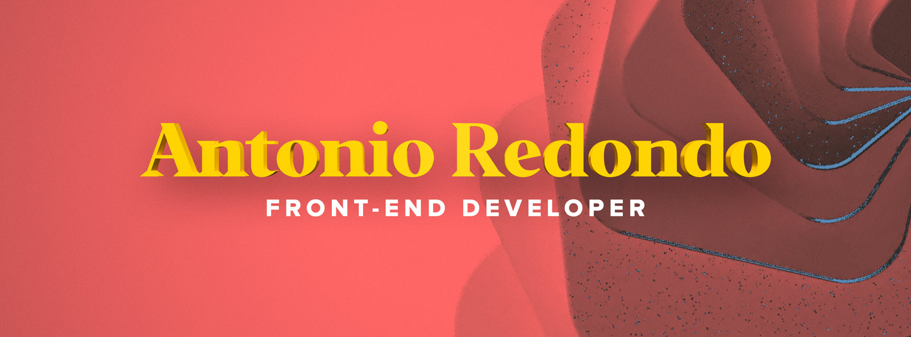

I am Antonio, a Spanish and British front-end software developer based in London since 2012. 

I craft with ❤️ JavaScript, HTML and CSS code. React and React Native are the frameworks I use the most. I also have good back-end skills in Node.js and Express.

I like to collaborate in open source projects. Projects of my own like the below ones pinned. And third-party projects:

* [html-webpack-inline-svg-plugin](https://github.com/theGC/html-webpack-inline-svg-plugin/pulls?q=author:AntonioRedondo)
* [react-native-maps-directions](https://github.com/bramus/react-native-maps-directions/pull/124)
* [react-weekly-day-picker](https://github.com/hurkanyakay/react-weekly-day-picker/pulls?q=author%3AAntonioRedondo)
* [webpack-atomizer-loader](https://github.com/acss-io/webpack-atomizer-loader/pulls?q=author%3AAntonioRedondo) ([link to new repo](https://github.com/acss-io/atomizer/commits/main/packages/webpack-atomizer-loader/README.md))
* [axios](https://github.com/axios/axios/issues/1259)
* [wappalyzer](https://github.com/wappalyzer/mcp/issues/2)

Check my portfolio on [antonioredondo.com](https://antonioredondo.com)
